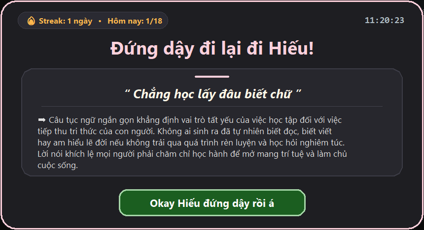

<div align="center">


# StandUpReminder — Trợ Lý Nhắc Đứng Dậy & Văn Hóa Dân Gian

**Giải pháp bảo vệ sức khỏe cột sống thông minh cho người làm việc trên máy tính Windows — Kết hợp nhịp vận động 30 phút khoa học, chống bấm nhầm theo phản xạ và kho tàng hàng trăm câu Ca dao Tục ngữ Việt Nam.**

[-0078D6?style=for-the-badge&logo=windows)](https://github.com)
[](https://www.python.org/)
[](../../releases)
[](https://github.com)
[](LICENSE)

[Tổng quan](#-tổng-quan-dự-án) • [Giao diện thực tế](#-giao-diện-thực-tế) • [Tính năng chuyên sâu](#-tính-năng-chuyên-sâu) • [Cài đặt & Sử dụng](#-hướng-dẫn-cài-đặt--sử-dụng) • [Kiến trúc kỹ thuật](#-kiến-trúc-kỹ-thuật) • [Tùy biến & Đóng gói](#-tùy-biến--đóng-gói-mã-nguồn) • [Câu hỏi thường gặp](#-câu-hỏi-thường-gặp-faq)

</div>

---

## 🎯 Tổng quan dự án

Ngồi làm việc liên tục hàng giờ trước màn hình máy tính là nguyên nhân hàng đầu gây ra thoái hóa cột sống, đau mỏi vai gáy, suy giảm thị lực và giảm hiệu suất tập trung. Tuy nhiên, các ứng dụng nhắc nhở thông thường thường mắc phải 3 nhược điểm lớn:
1. **Dễ bị bỏ qua hoặc tắt theo phản xạ:** Người dùng bấm tắt thông báo chỉ trong 0.5 giây rồi tiếp tục ngồi lì trên ghế.
2. **Nhàm chán:** Nội dung thông báo lặp đi lặp lại một câu duy nhất khiến não bộ dần "miễn nhiễm" với lời nhắc.
3. **Thiếu tính thực tế:** Vẫn bật thông báo ngay cả khi bạn đã rời khỏi bàn làm việc đi vệ sinh/pha nước, hoặc làm phiền ngoài giờ làm việc.

**StandUpReminder** được thiết kế để giải quyết triệt để cả 3 vấn đề trên bằng sự kết hợp giữa **cơ chế khóa phản xạ 5 giây**, **nhận diện trạng thái rảnh (Idle Detection)** ở cấp độ hệ điều hành Windows API, và **kho tàng Ca dao – Tục ngữ Việt Nam** được trình bày chuẩn mực như một thẻ tri thức mini mỗi 30 phút.

---

## 📸 Giao diện thực tế

<div align="center">
  
  <p><i>Thẻ thông báo nổi kích thước lớn (860px) bo góc mượt mà trên nền tối (Multi-Monitor Dim Overlay), hiển thị đồng hồ thực tế, chuỗi Streak, câu ca dao lục bát căn giữa kèm giải thích chi tiết và nút xác nhận có viền phát sáng.</i></p>
</div>

---

## ✨ Tính năng chuyên sâu

### 1. Hệ thống Đếm ngược & Hiển thị Trực quan (System Tray)
* **Biểu tượng động thời gian thực:** Thay vì một icon tĩnh nhàm chán, ứng dụng sử dụng thư viện `Pillow` để vẽ trực tiếp **số phút còn lại** nằm gọn bên trong một **vòng cung tiến trình (Circular Progress Ring)** ngay trên khay hệ thống Windows.
* **Mã hóa 3 cấp độ màu cảnh báo:**
  * 🟢 **Xanh lá (`20 – 30 phút`):** Trạng thái làm việc thoải mái, mới bắt đầu chu kỳ.
  * 🟠 **Vàng cam (`5 – 19 phút 59 giây`):** Đã ngồi được hơn nửa chu kỳ, chuẩn bị kết thúc phiên tập trung.
  * 🔴 **Đỏ (`0 – 4 phút 59 giây`):** Sắp đến giờ đứng dậy vận động.
* **Tooltip chi tiết:** Di chuột vào biểu tượng để xem chính xác số phút còn lại (`"Còn X phút đến thông báo"`) hoặc trạng thái tạm dừng/ngủ đông.

### 2. Cơ chế Chống Bấm Nhầm Theo Phản Xạ (Anti-Reflex Lock)
* Khi đến giờ, thẻ thông báo bật lên cùng lớp phủ làm tối nhẹ toàn bộ không gian màn hình.
* Nút xác nhận phía dưới được thiết kế bằng `SmoothProgressButton` tùy biến: trong **5 giây đầu tiên**, nút bị khóa và hiển thị thanh tiến trình màu tím chạy ngang (`Đợi 5s...` $\rightarrow$ `Đợi 1s...`).
* Khoảng thời gian 5 giây này đủ để ngắt mạch làm việc trên màn hình, buộc bạn phải thực sự đẩy ghế đứng dậy trước khi thanh tiến trình lấp đầy, chuyển sang màu xanh lá viền sáng và mở khóa dòng chữ **"Okay Hiếu đứng dậy rồi á"**.

### 3. Kho Ca dao Tục ngữ Thông minh (Smart Shuffle Deck)
* Tích hợp sẵn hàng trăm câu ca dao, tục ngữ Việt Nam chọn lọc kèm lời giải thích ý nghĩa sâu sắc.
* **Thuật toán rút bài không hoàn lại (Deck Shuffle):** Toàn bộ kho dữ liệu được xáo trộn thành một bộ bài và rút lần lượt từng câu. Bạn sẽ **không bao giờ gặp lại câu trùng lặp** trong suốt cả ngày làm việc, thậm chí cả tuần làm việc cho đến khi duyệt hết toàn bộ kho dữ liệu.
* **Tự động định dạng thể thơ Lục Bát:** Các câu ca dao có dấu phân cách `/` tự động được tách thành 2 dòng căn giữa chuẩn mực (câu 6 trên, câu 8 dưới), đặt trong khung trích dẫn riêng biệt tách bạch với phần giải nghĩa `➡`.

### 4. Nhận diện Trạng thái Rảnh & Quản lý Ca Làm Việc
* **Idle Detection (`GetLastInputInfo`):** Liên tục đo thời gian người dùng không tương tác với chuột và bàn phím. Nếu bạn chủ động đứng dậy rời khỏi máy tính quá **5 phút**, ứng dụng tự động hiểu rằng bạn đã nghỉ ngơi và âm thầm đặt lại bộ đếm về 30 phút — tránh tình trạng vừa quay lại ghế ngồi thì pop-up lại nhảy lên làm phiền.
* **Khung giờ làm việc tự động:** Mặc định chỉ hoạt động trong khung giờ hành chính **`08:00 AM – 05:00 PM`** theo đồng hồ hệ thống. Ngoài khung giờ này, icon chuyển sang trạng thái ngủ đông (`Zzz`) màu xám. Có thể bật/tắt nhanh chế độ chạy 24/24 chỉ bằng một cú click chuột phải.
* **Thống kê Kỷ luật (Daily Stats & Streak):** Tự động lưu lịch sử vào file `standup_stats.json`, hiển thị tiến độ trong ngày (ví dụ: `Hôm nay: 6/18 lần`) và duy trì chuỗi ngày liên tiếp (`🔥 Streak`).

### 5. Trải nghiệm Thị giác & Âm thanh Tinh tế
* **Hỗ trợ Đa màn hình (Multi-Monitor Dimming):** Truy xuất không gian hiển thị ảo (`SM_XVIRTUALSCREEN`, `SM_CXVIRTUALSCREEN`) để trải lớp phủ làm tối nền đồng bộ trên tất cả màn hình đang kết nối.
* **Bo góc Win32 Region mượt mà:** Kết hợp vẽ đa giác nội suy 16 điểm/góc với hàm `CreateRoundRectRgn` của Windows GDI32 để loại bỏ hoàn toàn phần viền vuông đen thừa thãi của cửa sổ không khung.
* **Hiệu ứng Tan biến (Ease-Out Cubic Fade-out):** Khi bấm nút xác nhận, cả thẻ thông báo lẫn lớp nền tối mờ dần mượt mà trong đúng **0.9 giây** ở tần số ~66 FPS.
* **Chuông báo êm tai (Synthesized Soft Chime):** Tự động tổng hợp sóng âm hợp âm trưởng (`C5 - E5 - G5`) tắt dần theo hàm mũ thành file `soft_chime.wav` nhẹ nhàng, không gây giật mình như tiếng `bell()` mặc định của Windows.

---

## 🚀 Hướng dẫn Cài đặt & Sử dụng

### Cách 1: Chạy trực tiếp bằng file `.exe` (Khuyên dùng)
Không cần cài đặt Python hay bất kỳ thư viện nào khác:
1. Vào mục **[Releases](../../releases)** ở cột bên phải và tải về file **`StandUpReminder.exe`**.
2. Tạo một thư mục cố định trên ổ cứng (ví dụ: `C:\Tools\StandUpReminder\`) và chép file `.exe` vào đó.
3. **Nhấp đúp chuột mở file `StandUpReminder.exe` 1 lần duy nhất.**
   * Ứng dụng sẽ tự động ghi đường dẫn vào Windows Registry (`HKCU\Software\Microsoft\Windows\CurrentVersion\Run`) để **tự khởi động cùng Windows** mỗi khi bật máy.
   * Kéo biểu tượng vòng tròn đếm ngược từ menu ẩn (`^`) ra ngoài thanh Taskbar cạnh đồng hồ để dễ quan sát màu sắc và số phút.

### Cách 2: Chạy từ mã nguồn Python
Yêu cầu máy tính đã cài đặt **Python 3.10 trở lên**:

```bash
# Bước 1: Clone repository về máy
git clone [https://github.com/Hieukhongbietcode/StandUpReminder.git](https://github.com/Hieukhongbietcode/StandUpReminder.git)
cd StandUpReminder

# Bước 2: Cài đặt 3 thư viện phụ thuộc
pip install customtkinter pystray pillow

# Bước 3: Chạy ngầm không hiện cửa sổ Console
pythonw StandUpReminder.py